# How to Bypass Google Family Link

## What You Need

- Android 9 or higher
- Google Family Link
- A Microsoft computer or an Xbox without parental controls (recommended, but not required)

## Instructions

**1. Install Microsoft Family Safety**

Install the Microsoft Family Safety app using this link:

https://play.google.com/store/apps/details?id=com.microsoft.familysafety&hl=en&pli=1

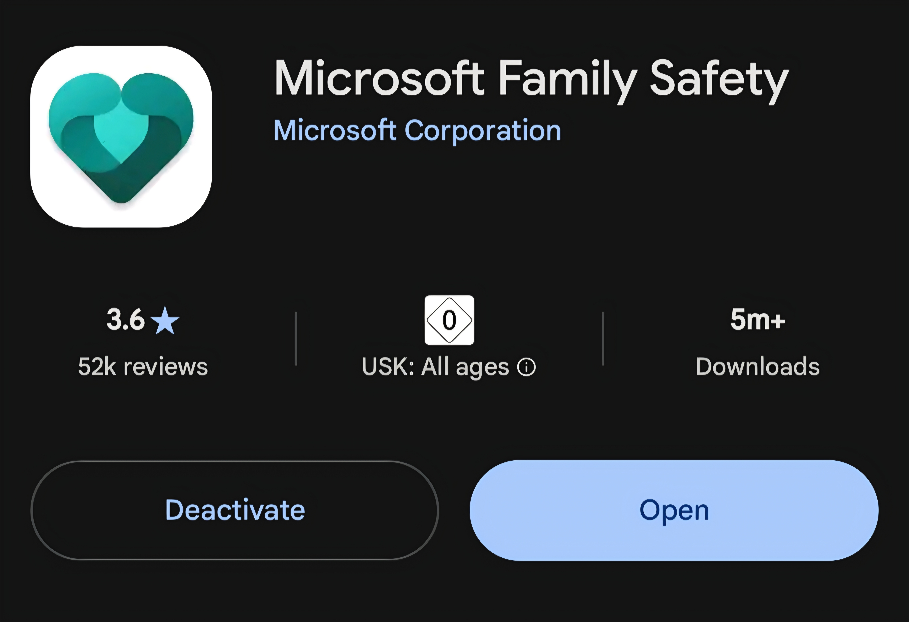

If your parents ask, you can explain that the app is used to manage and restrict access to your computer or Xbox.

**2. Grant Administrator Permissions**

Grant the app administrator permissions in your device settings:

**Settings → Three-dot menu → Special access → Device admin apps → Enable Family Safety**

**3. Navigate to Google and YouTube Through the App**

Open the app, tap the three-line menu 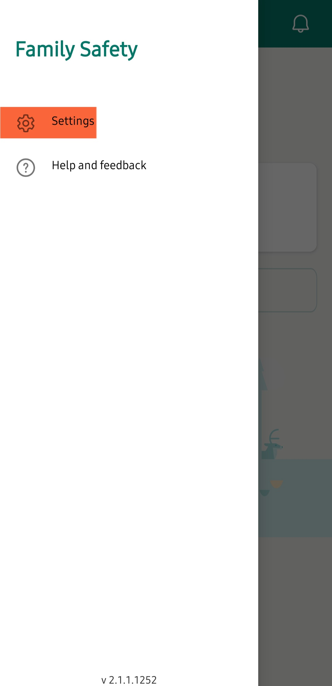, and then tap **"Settings"**.

Next, select **"Software licenses"** 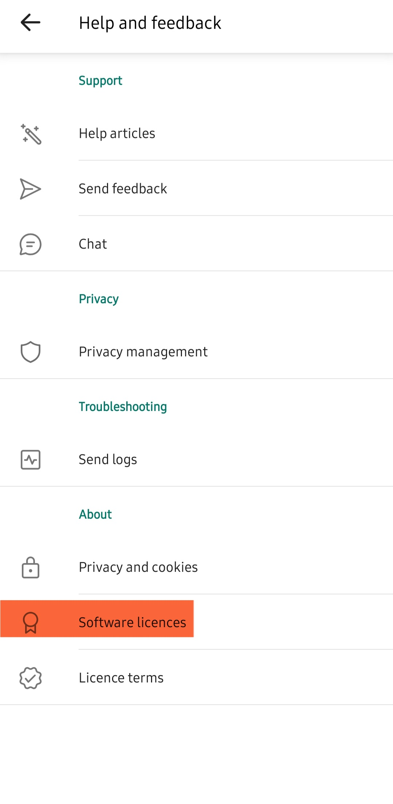.

Then tap the blue link https://3rdpartysource.microsoft.com 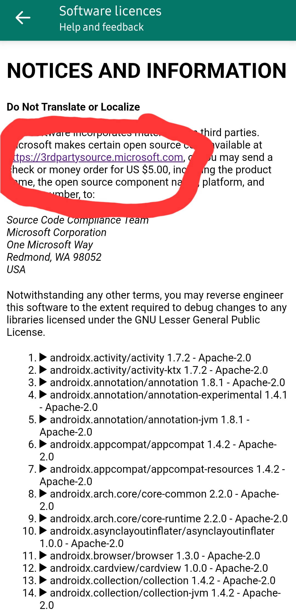.

Next, tap the Microsoft logo 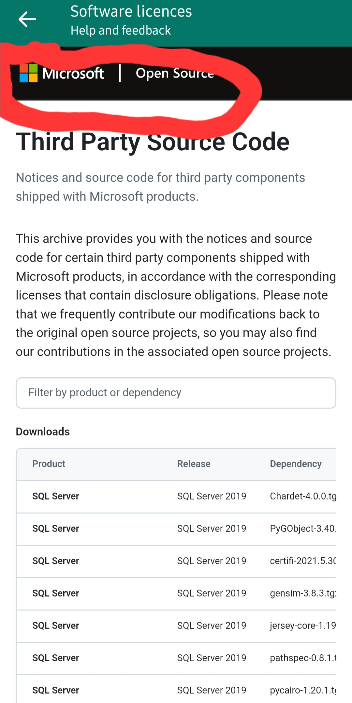.

Scroll down and tap **"Open at Microsoft"** next to the YouTube logo 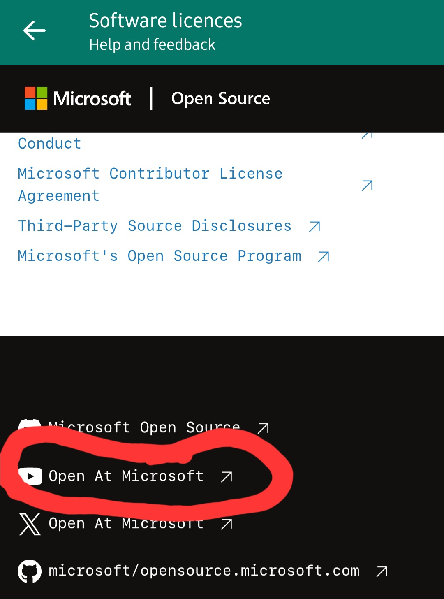.

You should now be on YouTube.

**4. Switch to Google**

Tap your profile picture in the bottom-right corner 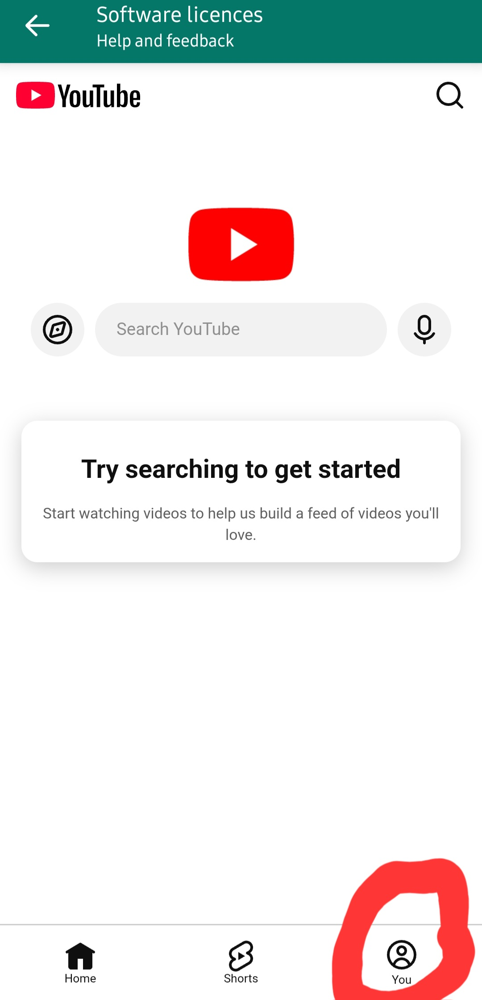, then tap **"Sign in"** 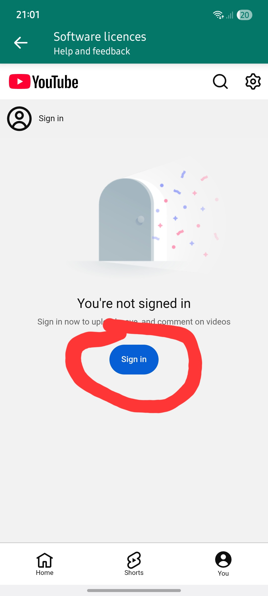.

Next, select **"Terms of Service"** 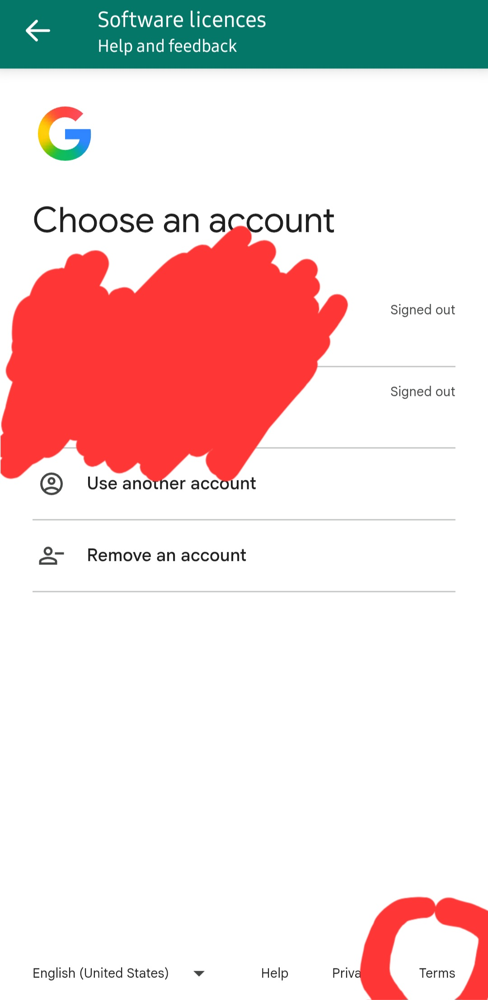.

Tap the nine-dot icon at the top 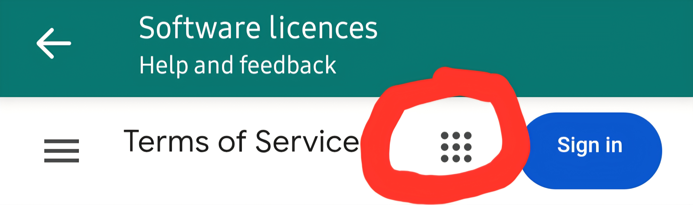 and then select **Google** 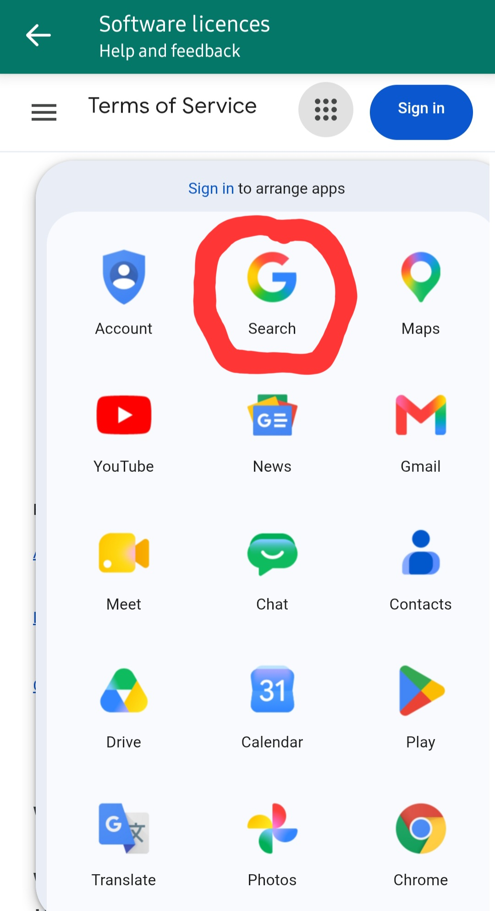.

You should now be able to access Google and YouTube without the usual restrictions.

**Note:** According to this guide, the method bypasses downtime by default. However, parents can still block the app.

## How Parents Can Prevent This

- Block the Microsoft Family Safety app on the device.
- Add the child's Microsoft account to a Microsoft Family group in advance and configure the available parental control settings accordingly.
